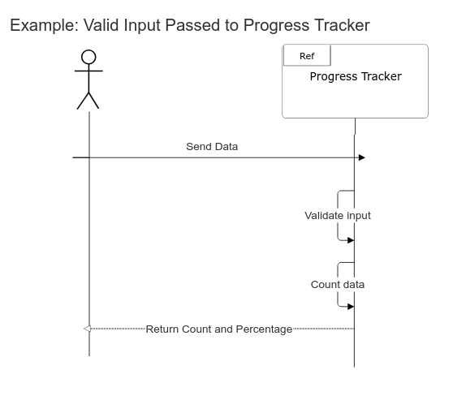

# Progress Tracker Microservice

## Description

This Microservice takes 3 inputs:

- An array of JSON objects that all contain at least one identical name
- a string representing the name of the value to search for
- A value to check for

It outputs:

- An int representing the number of objects whose value at the input name matches the input value
- A float representing the percentage of the total given objects that fit the same criteria

## Installation

Navigate into the directory containing progress_tracker.py and execute the following:

```bash
python3 -m venv .venv
```

For macOS/Linux:
```bash
source .venv/bin/activate
```

For Windows PowerShell:
```powershell
.\.venv\Scripts\Activate.ps1
```

Then install the dependencies:
```bash
python -m pip install -r requirements.txt
```

## Input and Retreival

~~~python
import subprocess as sp
import sys
import json
import zmq

# Set up socket
context = zmq.Context()

socket = context.socket(zmq.REQ)
socket.connect("tcp://localhost:5353")

# Run Progress tracker as a subprocess
pt = sp.Popen([sys.executable, "progress_tracker.py"])

# Create a list of dictionaries you want to search through. Here we will use:
TEST_DATA_BOOL_VALID = [
    {"completed": True},
    {"completed": True},
    {"completed": True},
    {"completed": False},
    {"completed": False}
]

#Create dictionary containing the search list, key to search, and value to check.
in_dict = {
    "check_data": TEST_DATA_BOOL_VALID,
    "check_name": "completed",
    "check_value": True
} # This will return the count and percentage of dicts which contain the value True at key "completed".

# Format input and send to progress_tracker
input_json = json.dumps(in_dict)
socket.send_json(input_json)

# Receive output from progress_tracker
output_json = socket.recv_json()
output_dict = json.loads(output_json)

print(output_dict)
# {"valid": True, "count": 3, "percentage": 60.0, "error_msg": None}

# End the program: When finished, send an end message to progress_tracker
in_dict = {
    "end": True
}
input_json = json.dumps(in_dict)
socket.send_json(input_json)

output_json = socket.recv_json()
output_dict = json.loads(output_json)

print(output_dict)
pt.wait()

~~~

### IMPORTANT: End the program

progress_tracker is designed to continuously wait for new input until told to end.
To end progress_tracker, send the following:

~~~python
request = {"end": True}

socket.send_json(json.dumps(request))

response_json = socket.recv_json()
response = json.loads(response_json)

pt.wait()
~~~

Make sure to end progress tracker when finished using it.

## Output format examples

Output is a JSON object containing four keys: "valid", "count", "percentage", and "error_msg".

### Valid Input

- valid: true
- count: int
-percentage: float
- error_msg: null

### Invalid Input

- valid: false
- count: null
-percentage: null
- error_msg: str

|Error Message                                               |Meaning                                                      |
|------------------------------------------------------------|-------------------------------------------------------------|
|"ERROR: List item {name} is not a dictionary."              |One or more of the items in the input list is not a dicionary|
|"ERROR: check_name {check_name} not present in all objects."|One or more dictionaries do not contain the input key.       |
|"ERROR: value type {typename} at name {check_name} in {dict} does not match type of check_value: {typename}."|One or more dictionaries contain the input key, but with a value of the wrong type.|
|"ERROR: Missing input."                                     |One or more of the three needed keys are missing from the input.|
|"ERROR: invalid check_data. must be list."                  |Value input at key check_data is not a list.                       |
|"error_msg": "ERROR: invalid check_name. must be string."   |value input at key check_name is not a string.                     |
| "ERROR: check_data cannot be empty." | The input list is empty, so a percentage cannot be calculated. |

## UML Diagram


