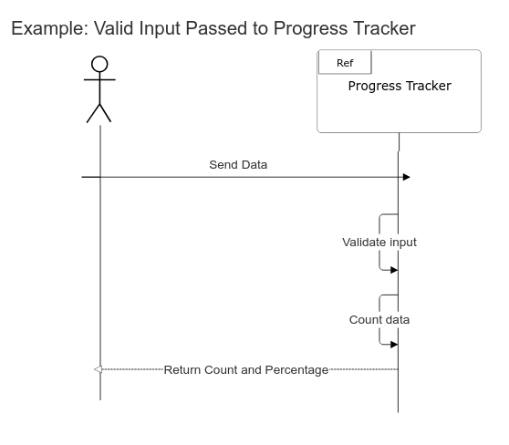

# Progress Tracker Microservice

## Description

This Microservice takes 3 inputs:

- An array of JSON objects that all contain at least one identical identical name
- a string representing the name of the value to search for
- A value to check for

It outputs:

- An int representing the number of objects whose value at the input name matches the input value
- A float representing the percentage of the total given objects that fit the same criteria

## Installation

Navigate into the directory containing progress_tracker.py and execute the following:

~~~text
python -m venv .venv
.\.venv\Scripts\Activate.ps1
python -m pip install -r requirements.txt
~~~

## Input and Retreival

~~~python
import multiprocessing as mp
import subprocess as sp
import json
import zmq

# Set up socket
context = zmq.Context()

print("Connecting to server...")

MESSAGE = "This is a message from CS361"

socket = context.socket(zmq.REQ)
socket.connect("tcp://localhost:5353")

# Run Progress tracker as a subprocess
def run_p_tracker():
    sp.run(["python3", "./progress_tracker.py"])

pt = mp.Process(target=run_p_tracker)
pt.start()

# Create a list of dictionaries you want to search through. Here we will use:
TEST_DATA_BOOL_VALID = [
    {"completed": True},
    {"completed": True},
    {"completed": True},
    {"completed": False},
    {"completed": False}
]

#Create dictionary containing the search list, key to search, and value to check.
in_dict = {
    "check_data": TEST_DATA_BOOL_VALID,
    "check_name": "completed",
    "check_value": True
} # This will return the count and percentage of dicts which contain the value True at key "completed".

# Format input and send to progress_tracker
input_json = json.dumps(in_dict)
socket.send_json(in_json)

# Receive output from progress_tracker
output_json = socket.recv_json()
output_dict = json.loads(output_json)

print(output_dict)
# {"valid": True, "count": 3, "percentage": 60.0, "error_msg": ""}

# End the program: When finished, send an end message to progress_tracker
in_dict = {
    "end": True
}
input_json = json.dumps(in_dict)
socket.send_json(in_json)

~~~

### IMPORTANT: End the program

progress_tracker is designed to continuously wait for new input until told to end.
To end progress_tracker, send it the following JSON object:

~~~json
{
    "end": True
}
~~~

Make sure to end progress tracker when finished using it.

## Output format examples

Output is a JSON object containing four keys: "valid", "count", "percentage", and "error_msg".

### Valid Input

- valid: true
- count: int
-percentage: float
- error_msg: null

### Invalid Input

- valid: false
- count: null
-percentage: null
- error_msg: str

|Error Message                                               |Meaning                                                      |
|------------------------------------------------------------|-------------------------------------------------------------|
|"ERROR: List item {name} is not a dictionary."              |One or more of the items in the input list is not a dicionary|
|"ERROR: check_name {check_name} not present in all objects."|One or more dictionaries do not contain the input key.       |
|"ERROR: value type {typename} at name {check_name} in {dict} does not match type of check_value: {typename}."|One or more dictionaries contain the input key, but with a value of the wrong type.|
|"ERROR: Missing input."                                     |One or more of the three needed keys are missing from the input.|
|"ERROR: invalid check_data. must be list."                  |Value input at key check_data is not a list.                       |
|"error_msg": "ERROR: invalid check_name. must be string."   |value input at key check_name is not a string.                     |

## UML Diagram

